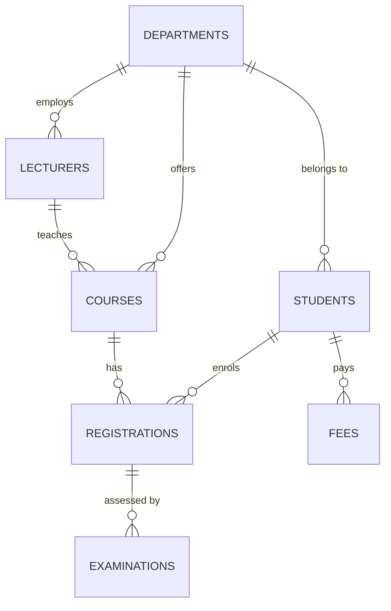

# Crestwood University Student Information Management System

An advanced database management system project for the design and implementation of a University Student Information Management System (USIMS).

The system stores student records, academic programmes, enrolment, examination results, and fee payments in a normalised MariaDB schema. A staff registry and public campus site sit on top of stored procedures, triggers, views, indexes, role-based security, and logical backup and recovery.

**Institution:** Crestwood University (demonstration)
**Duration:** 14 days
**DBMS:** MariaDB 10.11 / MySQL
**Application:** Node.js Express API and Vite frontend

---

## Academic structure

Crestwood University offers **104 academic programmes** across **six credential levels** and **five schools**.

| Credential | Programmes |
| --- | ---: |
| Certificate | 35 |
| Diploma | 25 |
| Advanced Diploma | 3 |
| Bachelor's degree | 37 |
| Master's degree | 3 |
| Doctorate (PhD) | 1 |
| **Total** | **104** |

### Schools

| School | Focus |
| --- | --- |
| School of Health Sciences | Nursing, clinical medicine, forensic science, medical biotechnology, public health |
| School of Pure and Applied Sciences | Computer science, information technology, actuarial science, applied statistics, mathematics |
| School of Hospitality and Textile Technology | Fashion design, travel and tourism, cosmetology, interior design, hospitality |
| School of Engineering and Technology | Civil, electrical, mechanical, telecommunication, chemical, and renewable energy engineering |
| School of Business and Education | Business, economics, accounting, human resources, and education |

Schools are stored once on `departments.faculty`. Student and course rows keep only a foreign key.

---

## Objectives

1. Design and implement a relational database of seven tables.
2. Normalise the design to Third Normal Form (3NF).
3. Implement stored procedures, triggers, and views.
4. Index student search and common join paths.
5. Create administrator and lecturer roles with least privilege.
6. Demonstrate backup and restore of the database.

---

## Modules

| Module | Function |
| --- | --- |
| Student management | Admit scholars, search the master file, amend standing |
| Course management | Maintain the 104-programme catalogue by school and credential |
| Course registration | Enrol active students on programmes |
| Examination management | Record marks; reject values outside 0–100; auto-assign grade |
| Fee management | Record bursary receipts with generated receipt numbers |
| DBA vault | Inspect objects, grants, indexes; create and restore dumps |

The public site presents Campus, Academics (filterable prospectus), and the staff registry.

---

## Advanced DBMS concepts

| Concept | Implementation |
| --- | --- |
| Normalisation | Seven tables in 3NF; no duplicated school, lecturer, or student names on child rows |
| Stored procedures | `sp_get_student_details`, `sp_register_student`, `sp_update_student`, `sp_register_course`, `sp_record_exam`, `sp_record_payment`, `sp_dashboard_stats` |
| Triggers | `trg_exam_marks_before_insert` / `_update` reject marks outside 0–100 and assign A–F; `trg_student_number_format` requires `CU` plus seven digits |
| Views | `vw_student_exam_results`, `vw_course_enrolment`, `vw_student_fee_summary` |
| Indexing | Last name, full name, email, status, department, credential level, and foreign-key join paths |
| Security | `sims_admin` (ALL on `usims`), `sims_lecturer` (academic read, examination write, no fees), `sims_app` (DML and EXECUTE for the API) |
| Backup and recovery | `mysqldump --single-transaction --routines --triggers --events`; restore via client replay or the DBA vault |

---

## Architecture

```
Browser  -->  Vite :5173  --/api proxy-->  Express :3001  -->  MariaDB :3306
              (campus + registry)          (REST, mysql2)       (usims)
```

The preview environment exposes one port. The frontend development server reverse-proxies `/api` to the backend, so Campus, Academics, and the registry share a single origin.

Express uses two pools configured entirely through environment variables:

- Application pool as `sims_app` for ordinary DML and routine calls (`DB_USER`, `DB_PASSWORD`)
- Admin pool for metadata, grants, backup, and restore (`DB_ADMIN_USER`, `DB_ADMIN_PASSWORD`, and `DB_ADMIN_HOST`)

Neither pool contains a built-in password or root-account fallback.

---

## Technology stack

| Layer | Software |
| --- | --- |
| Database | MariaDB 10.11 (MySQL compatible) |
| Backend | Node.js, Express, mysql2 |
| Frontend | Vite, vanilla JavaScript |
| Administration | SQL scripts, `mysqldump`, DBA vault in the web app |

---

## Repository layout

```text
.
|-- README.md
|-- start.sh
|-- backend/
|   |-- server.js
|   |-- db.js
|   `-- package.json
|-- frontend/
|   |-- index.html
|   |-- vite.config.js
|   |-- public/crest.svg
|   `-- src/
|-- database/
|   |-- 01_schema.sql
|   |-- 02_indexes.sql
|   |-- 03_views.sql
|   |-- 04_procedures.sql
|   |-- 05_triggers.sql
|   |-- 06_security.sql
|   |-- 07_sample_data.sql
|   |-- 08_install.sql
|   |-- 09_backup_recovery.sql
|   |-- 10_programme_catalogue.sql
|   `-- usims_full_dump.sql
|-- scripts/
|   |-- backup.sh
|   `-- restore.sh
|-- backups/ (local SQL dumps are ignored by Git)
|-- screenshots/ (add sanitized product screenshots)
`-- docs/PROJECT_REPORT.md
```

---

## Data model

Seven base tables:

| Table | Purpose |
| --- | --- |
| `departments` | School and department master |
| `lecturers` | Teaching staff |
| `students` | Scholar master file |
| `courses` | Programme catalogue, including `credential_level` |
| `registrations` | Student–course enrolment (M:N) |
| `examinations` | CA, midterm, and final marks |
| `fees` | Bursary receipts |



The full ERD, 3NF walk-through, and object catalogue are in `docs/PROJECT_REPORT.md`.

---

## Prerequisites

- MariaDB or MySQL 10.11+ (or 8.0+)
- Node.js 18+
- npm

---

## Installation

### 1. Create the database

Run as a privileged client (root / unix_socket):

```bash
mysql -u root --socket=/run/mysqld/mysqld.sock < database/01_schema.sql
mysql -u root --socket=/run/mysqld/mysqld.sock < database/02_indexes.sql
mysql -u root --socket=/run/mysqld/mysqld.sock < database/03_views.sql
mysql -u root --socket=/run/mysqld/mysqld.sock < database/04_procedures.sql
mysql -u root --socket=/run/mysqld/mysqld.sock < database/05_triggers.sql
mysql -u root --socket=/run/mysqld/mysqld.sock < database/06_security.sql
mysql -u root --socket=/run/mysqld/mysqld.sock < database/07_sample_data.sql
mysql -u root --socket=/run/mysqld/mysqld.sock < database/10_programme_catalogue.sql
```

TCP clients may omit `--socket` and pass `-h 127.0.0.1` instead.

### 2. Configure credentials

Copy the root `.env.example` to `.env` and set unique, randomly generated database credentials. Never commit `.env`. Create the `sims_app`, `sims_admin`, and `sims_lecturer` database accounts securely before running `database/06_security.sql`; that grants script contains no passwords. The API fails at startup if either application or administrator credentials are missing.

### 3. Install application dependencies

```bash
cd backend
npm install

cd ../frontend
npm install
```

### 4. Start both services

```bash
bash start.sh
```

`start.sh` starts MariaDB if it is not already running, launches the API on port 3001, and starts the Vite frontend on port 5173. Open `http://localhost:5173`.

---

## Database accounts

| User | Role | Privileges |
| --- | --- | --- |
| `sims_admin` | Administrator | `ALL PRIVILEGES` on `usims` |
| `sims_lecturer` | Lecturer | `SELECT` on academic tables; `INSERT`/`UPDATE` on `examinations`; `EXECUTE` on student lookup and exam recording; no access to `fees` |
| `sims_app` | Application | `SELECT`, `INSERT`, `UPDATE`, `DELETE`, `EXECUTE`, `SHOW VIEW` on `usims` |

No default passwords are provided. Set unique credentials outside source control and rotate any credentials that were previously committed.

---

## Application surfaces

| Surface | Purpose |
| --- | --- |
| Campus | Public landing page with live term statistics and school cards |
| Academics | Filterable prospectus of 104 programmes by school and credential |
| Staff registry | Operational desk for scholars, enrolment, examinations, bursary, and the DBA vault |

---

## Selected API routes

| Method | Path | Notes |
| --- | --- | --- |
| GET | `/api/health` | Database ping |
| GET | `/api/dashboard` | `sp_dashboard_stats`, grade mix, school programme counts |
| GET | `/api/students?q=` | `sp_get_student_details` |
| POST | `/api/students` | `sp_register_student` |
| GET | `/api/courses?school=&level=` | Catalogue, optional filters |
| POST | `/api/registrations` | `sp_register_course` (active students only) |
| POST | `/api/examinations` | `sp_record_exam` (trigger validates marks) |
| POST | `/api/fees` | `sp_record_payment` |
| GET | `/api/admin/objects` | Tables, views, indexes, routines, triggers, grants |
| POST | `/api/admin/backup` | Logical dump into `backups/` |
| POST | `/api/admin/restore` | Replay a dump file |

---

## Backup and recovery

Logical backup including routines, triggers, and events. Generated SQL dumps are local-only and excluded from Git; do not publish production backups. Use only anonymised synthetic data for any public demo fixture:

```bash
bash scripts/backup.sh
```

Restore:

```bash
bash scripts/restore.sh backups/usims_YYYYMMDD_HHMMSS.sql
```

The DBA vault can also seal a backup and restore it from the browser. Keep the generated files out of the public repository. Point-in-time recovery would require binary logging and is optional; see `database/09_backup_recovery.sql`.

---

## How to verify the required concepts

| Concept | Check |
| --- | --- |
| 3NF | Inspect `database/01_schema.sql`; child tables store keys, not copied names |
| Stored procedure | Search scholars on the Students desk |
| Trigger | Record marks of 101; the API returns `Examination marks must be between 0 and 100.` |
| View | Examinations desk reads `vw_student_exam_results` |
| Indexing | DBA vault lists indexes from `information_schema.STATISTICS` |
| Security | DBA vault shows `SHOW GRANTS`; lecturer cannot `SELECT` from `fees` |
| Backup | DBA vault: Seal a backup, then Restore |
| Catalogue | Academics page shows 104 programmes; Campus shows 35 / 25 / 3 / 37 / 3 / 1 |

---

## Sample data

`database/07_sample_data.sql` loads ten scholars, six lecturers, demonstration enrolments, examination scripts, and bursary receipts. `database/10_programme_catalogue.sql` loads the remaining programmes so the prospectus totals 104.

---

## Documentation

The project report, ERD, normalisation notes, and object catalogue are in `docs/PROJECT_REPORT.md`.

---

## Licence

Prepared as an academic demonstration for an Advanced DBMS coursework submission. Not licensed for production use without a separate agreement.
