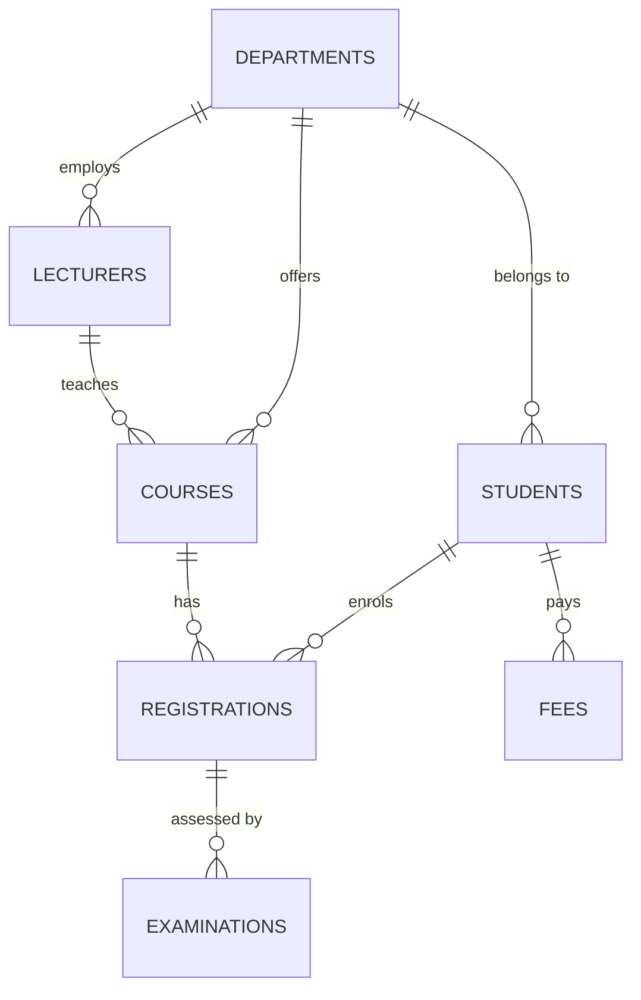

# University Student Information Management System (USIMS)

<div align="center">

  <p><strong>A database-driven university information platform for student records, academic programmes, enrolment, examinations, and fee management.</strong></p>

  <p>
    
    
    
    
  </p>

  <p>
    <a href="https://github.com/otienofrank27/University-Student-Information-Management-System"></a>
    <a href="https://github.com/otienofrank27/University-Student-Information-Management-System/network/members"></a>
    <a href="https://github.com/otienofrank27/University-Student-Information-Management-System/commits/main"></a>
  </p>

</div>

> **Project overview:** USIMS demonstrates relational database design, third normal form (3NF), stored procedures, triggers, views, indexing, database-level privilege separation, and backup/recovery workflows.

## Contents

- [Academic structure](#academic-structure)
- [Objectives](#objectives)
- [Modules](#modules)
- [Advanced DBMS concepts](#advanced-dbms-concepts)
- [Architecture](#architecture)
- [Technology stack](#technology-stack)
- [Repository layout](#repository-layout)
- [Data model](#data-model)
- [Prerequisites](#prerequisites)
- [Installation](#installation)
- [Database verification](#database-verification)
- [Evidence and screenshots](#evidence-and-screenshots)
- [Security controls](#security-controls)
- [Backup and recovery](#backup-and-recovery)
- [Documentation](#documentation)

An advanced database management system project for the design and implementation of a University Student Information Management System (USIMS).

The system stores student records, programme entries, enrolments, examination results, and fee payments in a normalised MariaDB schema. A staff registry and campus landing page sit on top of stored procedures, triggers, views, indexes, database-level privilege separation, and logical backup and recovery.

> **Data note:** Student, lecturer, department, course, examination, and fee records in the bundled SQL files are synthetic examples created for coursework demonstrations. They are not real people, verified university records, or an official prospectus. Replace them with institution-approved data before any real deployment.

**Project name:** University Student Information Management System (USIMS)
**Duration:** 14 days
**DBMS:** MariaDB 10.11 / MySQL
**Application:** Node.js Express API and Vite frontend

---

## Academic structure

The bundled **synthetic catalogue** contains 104 illustrative programme records across six credential levels and five sample schools. It is demonstration data, not an official university prospectus.

| Credential | Programmes |
| --- | ---: |
| Certificate | 35 |
| Diploma | 25 |
| Advanced Diploma | 3 |
| Bachelor's degree | 37 |
| Master's degree | 3 |
| Doctorate (PhD) | 1 |
| **Total** | **104** |

### Schools

| School | Focus |
| --- | --- |
| School of Health Sciences | Nursing, clinical medicine, forensic science, medical biotechnology, public health |
| School of Pure and Applied Sciences | Computer science, information technology, actuarial science, applied statistics, mathematics |
| School of Hospitality and Textile Technology | Fashion design, travel and tourism, cosmetology, interior design, hospitality |
| School of Engineering and Technology | Civil, electrical, mechanical, telecommunication, chemical, and renewable energy engineering |
| School of Business and Education | Business, economics, accounting, human resources, and education |

Schools are stored once on `departments.faculty`. Student and course rows keep only a foreign key.

---

## Objectives

1. Design and implement a relational database of seven tables.
2. Normalise the design to Third Normal Form (3NF).
3. Implement stored procedures, triggers, and views.
4. Index student search and common join paths.
5. Create administrator and lecturer roles with least privilege.
6. Demonstrate backup and restore of the database.

---

## Modules

| Module | Function |
| --- | --- |
| Student management | Admit scholars, search the master file, amend standing |
| Course management | Maintain the 104-programme catalogue by school and credential |
| Course registration | Enrol active students on programmes |
| Examination management | Record marks; reject values outside 0–100; auto-assign grade |
| Fee management | Record bursary receipts with generated receipt numbers |
| DBA vault | Inspect objects, grants, indexes; create and restore dumps |

The public site presents Campus, Academics (filterable prospectus), and the staff registry.

---

## Advanced DBMS concepts

| Concept | Implementation |
| --- | --- |
| Normalisation | Seven tables in 3NF; no duplicated school, lecturer, or student names on child rows |
| Stored procedures | `sp_get_student_details`, `sp_register_student`, `sp_update_student`, `sp_register_course`, `sp_record_exam`, `sp_record_payment`, `sp_dashboard_stats` |
| Triggers | `trg_exam_marks_before_insert` / `_update` reject marks outside 0–100 and assign A–F; `trg_student_number_format` and `trg_student_number_format_before_update` enforce `CU` plus seven digits on insert and update |
| Views | `vw_student_exam_results`, `vw_course_enrolment`, `vw_student_fee_summary` |
| Indexing | Last name, full name, email, status, department, credential level, and foreign-key join paths |
| Security | `sims_admin` (ALL on `usims`), `sims_lecturer` (academic read, examination write, no fees), `sims_app` (DML and EXECUTE for the API) |
| Backup and recovery | `mysqldump --single-transaction --routines --triggers --events`; restore via client replay or the DBA vault |

---

## Architecture

```
Browser  -->  Vite :5173  --/api proxy-->  Express :3001  -->  MariaDB :3306
              (campus + registry)          (REST, mysql2)       (usims)
```

The preview environment exposes one port. The frontend development server reverse-proxies `/api` to the backend, so Campus, Academics, and the registry share a single origin.

Express uses two pools configured entirely through environment variables:

- Application pool as `sims_app` for ordinary DML and routine calls (`DB_USER`, `DB_PASSWORD`)
- Admin pool for metadata, grants, backup, and restore (`DB_ADMIN_USER`, `DB_ADMIN_PASSWORD`, and `DB_ADMIN_HOST`)

Neither pool contains a built-in password or root-account fallback.

---

## Technology stack

| Layer | Software |
| --- | --- |
| Database | MariaDB 10.11 (MySQL compatible) |
| Backend | Node.js, Express, mysql2 |
| Frontend | Vite, vanilla JavaScript |
| Administration | SQL scripts, `mysqldump`, DBA vault in the web app |

---

## Repository layout

```text
.
|-- README.md
|-- start.sh
|-- backend/
|   |-- server.js
|   |-- db.js
|   `-- package.json
|-- frontend/
|   |-- index.html
|   |-- vite.config.js
|   |-- public/crest.svg
|   `-- src/
|-- database/
|   |-- 01_schema.sql
|   |-- 02_indexes.sql
|   |-- 03_views.sql
|   |-- 04_procedures.sql
|   |-- 05_triggers.sql
|   |-- 06_security.sql
|   |-- 07_sample_data.sql
|   |-- 08_install.sql
|   |-- 09_backup_recovery.sql
|   |-- 10_programme_catalogue.sql
|   `-- usims_full_dump.sql
|-- scripts/
|   |-- backup.sh
|   `-- restore.sh
|-- backups/ (local SQL dumps are ignored by Git)
|-- screenshots/ (add sanitized product screenshots)
`-- docs/PROJECT_REPORT.md
```

---

## Data model

Seven base tables:

| Table | Purpose |
| --- | --- |
| `departments` | School and department master |
| `lecturers` | Teaching staff |
| `students` | Scholar master file |
| `courses` | Programme catalogue, including `credential_level` |
| `registrations` | Student–course enrolment (M:N) |
| `examinations` | CA, midterm, and final marks |
| `fees` | Bursary receipts |



The full ERD, 3NF walk-through, and object catalogue are in `docs/PROJECT_REPORT.md`.

---

## Prerequisites

- MariaDB or MySQL 10.11+ (or 8.0+)
- Node.js 18+
- npm

---

## Installation

### 1. Create the database

On Linux, macOS, or Git Bash, start MySQL/MariaDB and run the portable installer from the repository root:

```bash
bash scripts/install-database.sh
```

**Important:** `database/01_schema.sql` drops and recreates the `usims` database. Back up any existing `usims` database before installation. The script uses the `mysql` client on `PATH`. Configure `DB_HOST`, `DB_PORT`, and `DB_INSTALL_USER` if your local server differs from the defaults. Set `DB_INSTALL_PASSWORD` in the environment when a non-interactive password is required. The installer creates the schema and loads sample data; it skips grants unless `INSTALL_DB_GRANTS=true` is set after the three database accounts have been provisioned.

You can also run the SQL files individually in this order: `01_schema.sql`, `02_indexes.sql`, `03_views.sql`, `04_procedures.sql`, `05_triggers.sql`, `07_sample_data.sql`, and `10_programme_catalogue.sql`. Apply `06_security.sql` only after creating `sims_app`, `sims_admin`, and `sims_lecturer` with separate strong passwords. The `database/08_install.sql` master file uses relative `SOURCE` paths and must be invoked from the repository root:

```bash
mysql -u root -p < database/08_install.sql
```

### XAMPP / Windows

Start MySQL in the XAMPP Control Panel. In PowerShell, run the SQL files individually using the XAMPP client, for example:

```powershell
& "C:\xampp\mysql\bin\mysql.exe" -u root -p < database\01_schema.sql
```

Repeat for the remaining SQL files in the order above. Alternatively, use Git Bash with `bash scripts/install-database.sh` after adding the XAMPP `mysql/bin` directory to `PATH`. phpMyAdmin users can import the SQL files individually in the same order.

### 2. Configure credentials and administrator access

Copy the root `.env.example` to `.env` and set unique, randomly generated database credentials. Never commit `.env`. Create the `sims_app`, `sims_admin`, and `sims_lecturer` database accounts securely before running `database/06_security.sql`; that grants script contains no passwords.

Generate the administrator password hash and session signing secret:

```bash
node scripts/hash-password.js
openssl rand -hex 32
```

Run the hash utility in an interactive terminal; it prompts for the password without echoing it. Copy the printed `AUTH_PASSWORD_HASH=...` line into `.env`, choose an `AUTH_USERNAME`, and put the random output in `SESSION_SECRET`. Never store the plain administrator password in source control. The API refuses to start if these authentication settings or database credentials are missing. Sign-in uses an eight-hour HttpOnly, SameSite=Strict session cookie; login attempts are rate limited. In production, serve the app over HTTPS so the cookie is Secure.

The registry API requires authentication. The database vault endpoints additionally require the administrator role. Configure `CORS_ORIGIN` only when the frontend is hosted on a separate origin; list exact trusted origins separated by commas. Same-origin hosting is preferred.

### 3. Install application dependencies

```bash
cd backend
npm install

cd ../frontend
npm install
```

### 4. Start both services

```bash
bash start.sh
```

`start.sh` starts MariaDB if it is not already running, launches the API on port 3001, and starts the Vite frontend on port 5173. Open `http://localhost:5173`.

---

## Database accounts

| User | Role | Privileges |
| --- | --- | --- |
| `sims_admin` | Administrator | `ALL PRIVILEGES` on `usims` |
| `sims_lecturer` | Database lecturer account | `SELECT` on academic tables; `INSERT`/`UPDATE` on `examinations`; no access to `fees` |
| `sims_app` | Application | `SELECT`, `INSERT`, `UPDATE`, `DELETE`, `EXECUTE`, `SHOW VIEW` on `usims` |

These are MariaDB accounts and grants, not three application login roles. The current web interface has one configured administrator login; a separate lecturer web login is not implemented. No default passwords are provided. Set unique credentials outside source control.

---

## Security controls

- All registry API routes require a signed, expiring administrator session; the health endpoint exposes only database reachability.
- Login uses scrypt password hashes, HttpOnly / SameSite=Strict cookies, and per-IP login throttling.
- Administrative database-inspection, backup, and restore endpoints explicitly require the administrator role. The current web application does not expose lecturer sign-in or per-lecturer record scoping.
- API request bodies are size-limited; API errors do not return SQL messages or stack details.
- CORS is disabled by default and can be enabled only for exact origins using `CORS_ORIGIN`; same-origin hosting is recommended.
- Responses include browser security headers and API responses are marked non-cacheable.
- These controls are not a substitute for HTTPS, operating-system hardening, database network restrictions, tested backups, and a security review before handling real student data.

## Application surfaces

| Surface | Purpose |
| --- | --- |
| Campus | Public landing page with live term statistics and school cards |
| Academics | Filterable catalogue of synthetic programme records by school and credential |
| Staff registry | Operational desk for scholars, enrolment, examinations, bursary, and the DBA vault |

---

## Selected API routes

| Method | Path | Notes |
| --- | --- | --- |
| GET | `/api/health` | Database ping |
| GET | `/api/dashboard` | `sp_dashboard_stats`, grade mix, school programme counts |
| GET | `/api/students?q=` | `sp_get_student_details` |
| POST | `/api/students` | `sp_register_student` |
| GET | `/api/courses?school=&level=` | Catalogue, optional filters |
| POST | `/api/registrations` | `sp_register_course` (active students only) |
| POST | `/api/examinations` | `sp_record_exam` (trigger validates marks) |
| POST | `/api/fees` | `sp_record_payment` |
| GET | `/api/admin/objects` | Tables, views, indexes, routines, triggers, and grants for the configured admin connection |
| POST | `/api/admin/backup` | Logical dump into `backups/` |
| POST | `/api/admin/restore` | Replay a dump file |

---

## Automated checks

GitHub Actions runs the backend authentication tests, builds the frontend, installs a clean MariaDB 10.11 schema, checks required database objects and invalid-mark triggers, then performs a logical backup/restore probe. The workflow is defined in `.github/workflows/ci.yml`. A green workflow run is required before treating these checks as passing; local setup and institution-specific acceptance testing remain separate.

## Database verification

After installation, run the automated structural and trigger checks:

```bash
bash scripts/verify-database.sh
```

The script checks the seven base tables, required views, stored procedures, triggers, student-search indexes, sample registrations, and confirms that insert and update attempts with a mark of 101 are rejected, and that an invalid student-number update is blocked. It does not change valid student or examination data. It requires a MySQL/MariaDB client and a database account with read access plus permission to attempt the rejected examination writes.

## Backup and recovery

Logical backup including routines, triggers, and events. Generated SQL dumps are local-only and excluded from Git; do not publish production backups. Use only anonymised synthetic data for any public demo fixture:

```bash
bash scripts/backup.sh
```

Restore:

```bash
bash scripts/restore.sh backups/usims_YYYYMMDD_HHMMSS.sql
```

The DBA vault can also seal a backup and restore it from the browser. Keep the generated files out of the public repository. Point-in-time recovery would require binary logging and is optional; see `database/09_backup_recovery.sql`.

---

## How to verify the required concepts

| Concept | Check |
| --- | --- |
| 3NF | Inspect `database/01_schema.sql`; child tables store keys, not copied names |
| Stored procedure | Search scholars on the Students desk |
| Trigger | Record marks of 101; the API returns `Examination marks must be between 0 and 100.` |
| View | Examinations desk reads `vw_student_exam_results` |
| Indexing | DBA vault lists indexes from `information_schema.STATISTICS` |
| Security | DBA vault shows `SHOW GRANTS`; lecturer cannot `SELECT` from `fees` |
| Backup | DBA vault: Seal a backup, then Restore |
| Catalogue | Academics page shows 104 programmes; Campus shows 35 / 25 / 3 / 37 / 3 / 1 |

---

## Sample data

`database/07_sample_data.sql` loads ten scholars, six lecturers, demonstration enrolments, examination scripts, and bursary receipts. `database/10_programme_catalogue.sql` loads the remaining programmes so the prospectus totals 104.

---

## Evidence and screenshots

The `screenshots/` directory contains instructions for collecting genuine evidence. Capture the dashboard, student search, course catalogue, registration, examination results, fee management, ERD, and successful verification output from a running installation. Use synthetic records only and remove personal or financial information. Do not submit mock screenshots as execution evidence.

## Documentation

The project report, ERD, normalisation notes, installation procedure, verification steps, and evidence checklist are in `docs/PROJECT_REPORT.md`.

---

## Licence

Prepared as an academic demonstration for an Advanced DBMS coursework submission. Not licensed for production use without a separate agreement.
