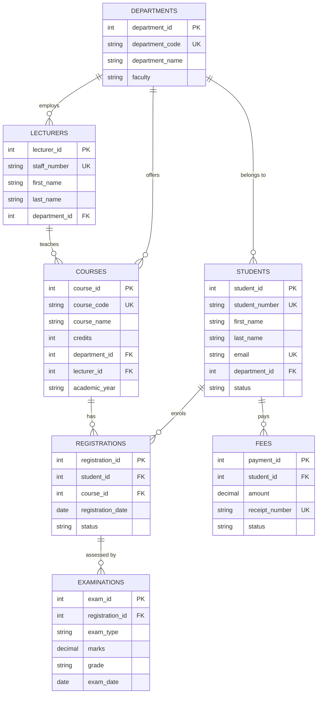

# Design and Implementation of a University Student Information Management System

**Institution:** Crestwood University (demonstration)
**Duration:** 14 days
**DBMS:** MariaDB 10.11 / MySQL
**Application:** Node.js Express API and Vite frontend

## 1. Introduction

Universities generate large volumes of structured data: student identities, course catalogues, registrations, examination results, and fee payments. Spreadsheet-style storage quickly produces redundancy, inconsistent grades, and weak access control.

This project implements a relational Student Information Management System (USIMS) that stores those records in Third Normal Form, exposes them through constrained SQL objects, and demonstrates indexing, role-based security, and logical backup/recovery.

## 2. Objectives

1. Design and implement a relational database of seven tables.
2. Normalise the design to Third Normal Form.
3. Implement stored procedures, triggers, and views.
4. Index student search and common join paths.
5. Create administrator and lecturer roles with least privilege.
6. Demonstrate backup and restore of the database.

## 3. Scope

Five operational modules were implemented:

| Module | Function |
| --- | --- |
| Student management | Register and maintain student records |
| Course management | Maintain the course catalogue |
| Course registration | Enrol students on courses |
| Examination management | Store and retrieve marks and grades |
| Fee management | Record student payments |

## 4. Entity Relationship Diagram

Relationships:

- One department has many students, lecturers, and courses.
- One lecturer may teach many courses.
- Students and courses are many-to-many, resolved by `registrations`.
- Each registration may have several examination components (CA, Midterm, Final).
- One student may have many fee payments.

## 5. Normalisation to 3NF

### 5.1 Unnormalised starting point

A typical registry spreadsheet repeats student name, department name, course title, lecturer name, and faculty on every registration or result row. That form contains repeating groups and transitive dependencies such as `department_name -> faculty`.

### 5.2 First Normal Form

Atomic attributes only. Repeating course lists were extracted into `registrations`. Multi-valued exam components became separate rows in `examinations`.

### 5.3 Second Normal Form

Composite natural keys such as `(student_number, course_code)` would leave `student_name` dependent only on `student_number`. Surrogate primary keys plus a unique `(student_id, course_id)` constraint keep non-key attributes fully dependent on the whole key.

### 5.4 Third Normal Form

Transitive dependencies were removed:

- Faculty depends on department, not on student, so it lives in `departments`.
- Lecturer name depends on `lecturer_id`, not on `course_id`.
- Grade is derived from marks by a trigger rather than stored as an independent fact that could drift.
- Receipt identity is unique on `fees`; student contact data is not copied onto payment rows.

The seven tables therefore satisfy 3NF: every non-key attribute depends on the key, the whole key, and nothing but the key.

## 6. Schema summary

| Table | Purpose | Key constraints |
| --- | --- | --- |
| departments | Academic units | Unique code and name |
| lecturers | Teaching staff | Unique staff number and email; FK to department |
| students | Student master | Unique student number and email; FK to department |
| courses | Catalogue | Unique course code; FK to department and lecturer |
| registrations | Enrolment | Unique student+course |
| examinations | Results | Unique registration+exam type |
| fees | Payments | Unique receipt; amount > 0 |

## 7. Advanced database objects

### 7.1 Stored procedures

| Procedure | Role |
| --- | --- |
| `sp_get_student_details` | Search students by number, name, or email |
| `sp_register_student` | Insert a student and return the new id |
| `sp_update_student` | Update student master data |
| `sp_register_course` | Enrol an active student; reject inactive ones |
| `sp_record_exam` | Insert an examination row |
| `sp_record_payment` | Insert a fee row with generated receipt number |
| `sp_dashboard_stats` | Aggregate counts for the overview screen |

### 7.2 Triggers

`trg_exam_marks_before_insert` and `trg_exam_marks_before_update` reject marks outside 0–100 with `SIGNAL SQLSTATE '45000'` and assign letter grades:

- A: 80–100
- B: 70–79
- C: 60–69
- D: 50–59
- F: below 50

`trg_student_number_format` requires student numbers of the form `CU` plus seven digits.

### 7.3 Views

- `vw_student_exam_results` — joined student, course, lecturer, marks, and grade
- `vw_course_enrolment` — headcount per course
- `vw_student_fee_summary` — paid versus pending totals

### 7.4 Indexing

Non-unique indexes were added on student last name, full name, email, status, and department, plus foreign-key and filter columns on courses, registrations, examinations, and fees. Unique constraints already provide unique indexes on student number, email, course code, and receipt number.

### 7.5 Security

Three MariaDB accounts implement least privilege:

- `sims_admin@localhost` — `ALL PRIVILEGES` on `usims`
- `sims_lecturer@localhost` — `SELECT` on academic tables, `INSERT/UPDATE` on `examinations`, no access to `fees`
- `sims_app@localhost` — DML and `EXECUTE` for the web API

### 7.6 Backup and recovery

Logical backups are produced with `mysqldump --single-transaction --routines --triggers --events`. Restore is a client replay of the dump. The DBA Console and `scripts/backup.sh` / `scripts/restore.sh` both exercise this path.

## 8. Application architecture

The preview environment exposes one port. A Vite development server therefore reverse-proxies `/api` to Express on port 3001. Express uses `mysql2` connection pools: an application pool as `sims_app` and an admin pool over the local socket for metadata, grants, backup, and restore.

## 9. Sample data

The academic catalogue holds 104 programmes across six credential levels:

- Certificates: 35
- Diplomas: 25
- Advanced Diplomas: 3
- Bachelor's degrees: 37
- Master's degrees: 3
- Doctorates: 1

They are distributed across five schools:

- School of Health Sciences
- School of Pure and Applied Sciences
- School of Hospitality and Textile Technology
- School of Engineering and Technology
- School of Business and Education

Sample students, registrations, examinations, and payments sit under those schools so queries, the exam-mark trigger, and screenshots can be demonstrated immediately. The full catalogue is in `database/10_programme_catalogue.sql`.

## 10. Testing the required concepts

| Concept | How to verify |
| --- | --- |
| 3NF | Inspect `01_schema.sql`; no duplicated names on child tables |
| Stored procedure | Search students on the Students page |
| Trigger | Record marks of 101; the API returns the rejection message |
| View | Examinations page reads `vw_student_exam_results` |
| Indexing | DBA Console lists indexes from `information_schema.STATISTICS` |
| Security | DBA Console shows `SHOW GRANTS` for admin and lecturer |
| Backup | DBA Console “Create backup”, then Restore |

## 11. Limitations and further work

The two-week scope omits timetable, hostel, and online payment gateways. Binary logging for point-in-time recovery is optional and not enabled by default. A production deployment would add TLS, hashed application passwords, and audited logins.

## 12. Conclusion

USIMS stores university student information in a normalised MariaDB schema and demonstrates the advanced DBMS features required by the brief: procedures, triggers, views, indexes, roles, and backup/recovery, with a working five-module application on top.
